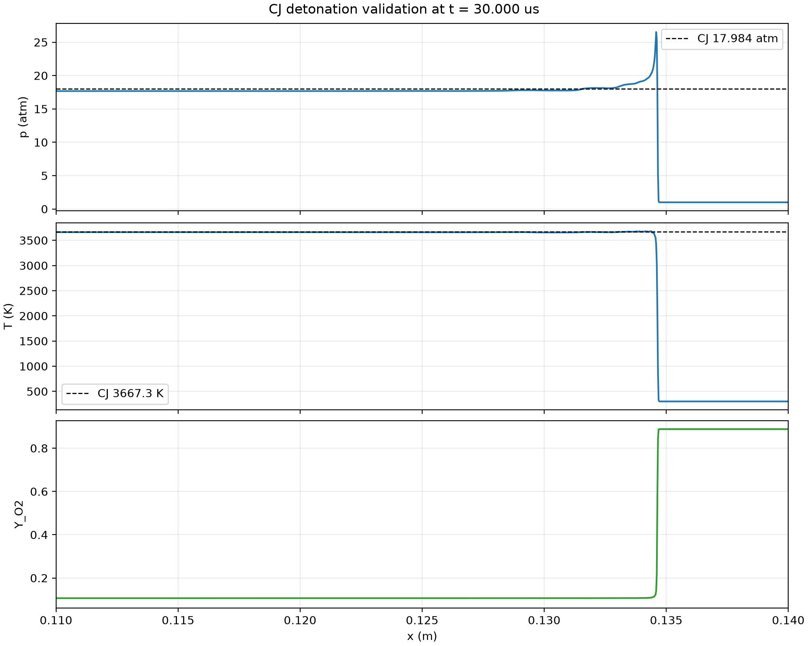

# 平面 CJ 爆轰验证

本算例独立于经验二维 DDT 初值，用于检查完整的 AMReX/CUDA 反应流路径：

- 未燃混合物：化学计量 H2/O2，300 K、1 atm；
- 左段：Cantera 计算得到的平衡 CJ 状态；
- 初值包含 CJ 波后速度、压力、温度和 9 组分质量分数；
- 展向周期、无扰动，最细网格为 25 μm；
- 三层 2:1 AMR，完整覆盖 HLLC、化学积分、AMR 和 GPU 路径。

## Cantera 参考值

当前 9 组分、21 反应机理的参考值为：

```text
D_CJ   = 2838.5 m/s
p_CJ   = 17.984 atm
T_CJ   = 3667.3 K
rho_CJ = 0.86776 kg/m3
u_CJ   = 1242.65 m/s
```

## 运行

```bash
DETONATION_RUN_DIR=runs/cj-validation \
  ./scripts/run_case.sh examples/h2o2_2d_demo/inputs-cj-validation
```

## 波速结果

实测压力锋区间平均速度为：

```text
 5-10 μs: 2829.5 m/s
10-15 μs: 2829.8 m/s
15-20 μs: 2830.6 m/s
20-25 μs: 2830.2 m/s
25-30 μs: 2830.1 m/s

5-30 μs 总体速度: 2830.03 m/s
相对 CJ 误差:       -0.30%
```

五个连续区间内波速变化约 1.1 m/s。压力锋和反应锋在 30 μs 前保持重合，
AMR 最细层持续为第 3 层。

## 30 μs 波后状态

| 物理量 | Cantera CJ | 当前求解器 | 相对误差 |
|---|---:|---:|---:|
| 压力 | 17.984 atm | 18.024 atm | +0.23% |
| 温度 | 3667.3 K | 3666.4 K | -0.02% |
| 密度 | 0.86776 kg/m3 | 0.86983 kg/m3 | +0.24% |
| 速度 | 1242.65 m/s | 1246.02 m/s | +0.27% |



图：30 μs 的 P–x、T–x 和 O2–x 剖面。前导激波后出现狭窄 von Neumann 峰，
随后进入 CJ 平台。

## 验证边界

本算例验证给定 CJ 初值后反应 Euler、HLLC、化学、AMR、GPU 和输出链路的
传播能力。它不是网格无关性验证，也不是反应机理的实验验证。完整二维 DDT
转捩路径仍需通过网格收敛、扰动敏感性和 AMR 事件顺序研究。
