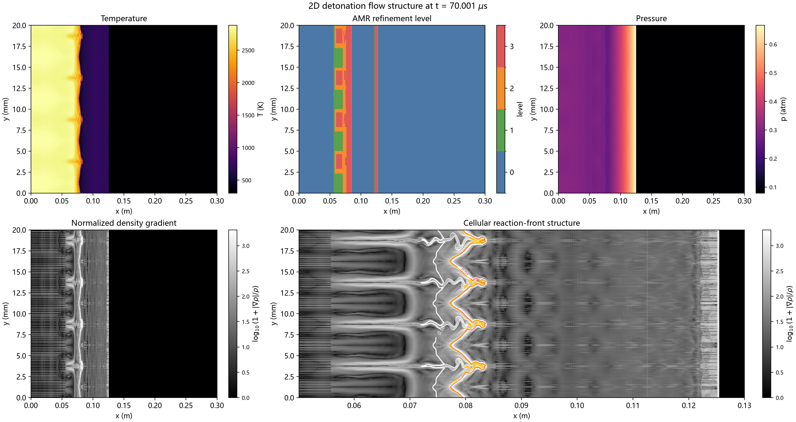
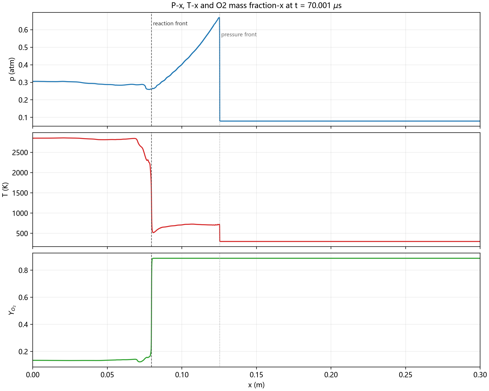
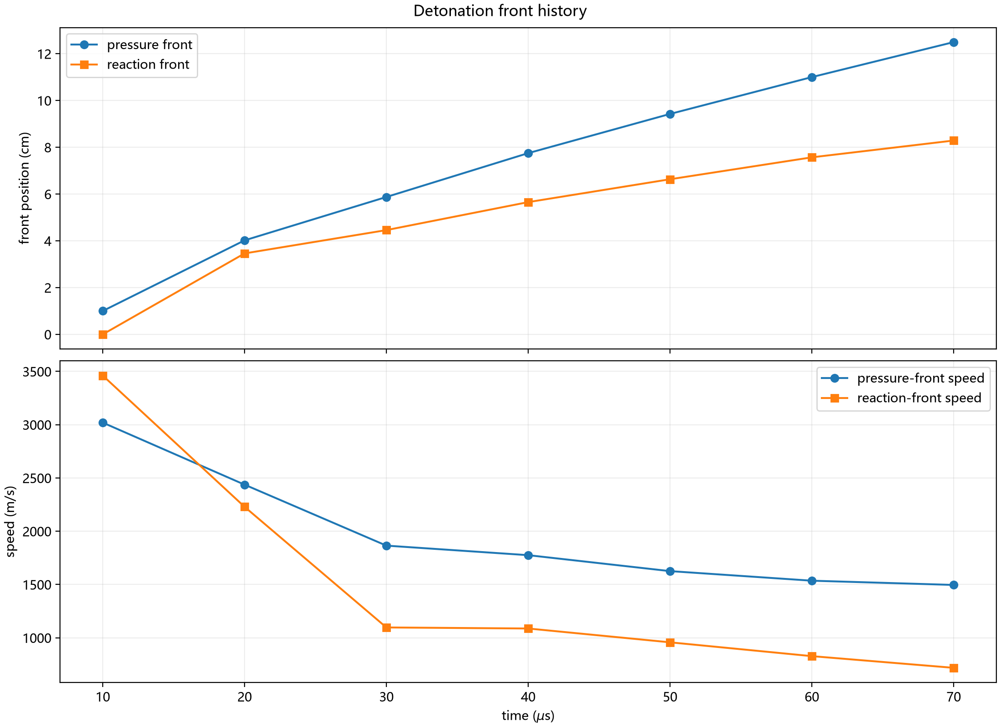
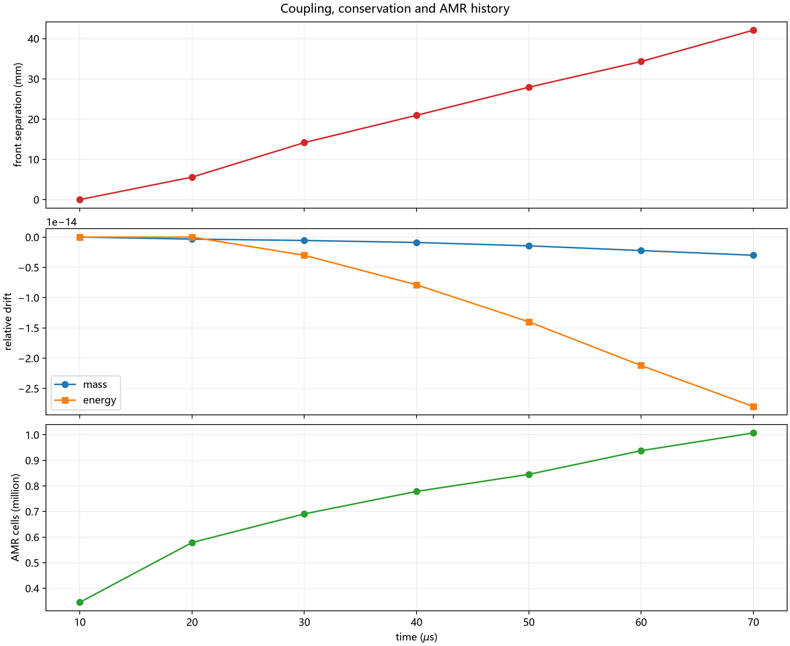
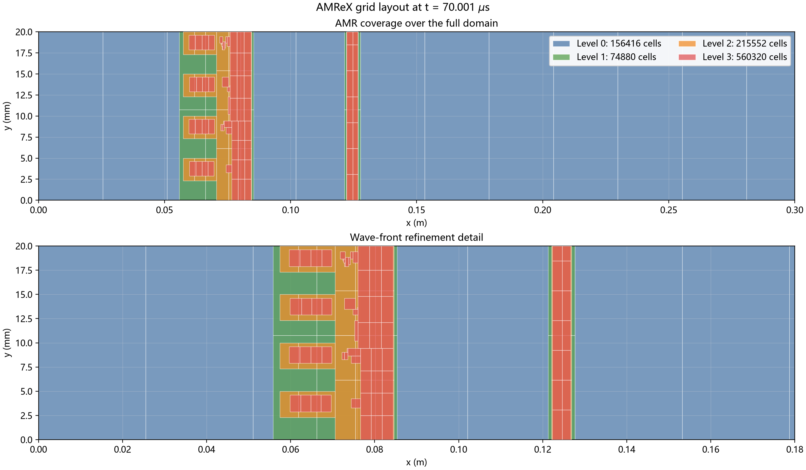

# 70 微秒算例诊断

## 算例和状态

- 输入：`examples/h2o2_2d_demo/inputs-long`
- 计算域：`0.30 m x 0.02 m`
- 停止目标：75 μs
- 最后场输出：70.001 μs
- 最后状态：71.412 μs
- 最大 AMR 层：3
- 总单元数：约 101 万

## 结果图

### 温度、压力、AMR 和密度梯度

图中温度较高的已燃气体位于左侧，O₂ 消耗完成；右侧仍为未燃混合物。前导压力
跃变位于约 12.5 cm，而反应区位于约 8.0 cm，两者相距约 4.2 cm。

### P-x、T-x 和 O₂ 质量分数

中心线曲线表明：

- 反应区左侧温度约 2500–2850 K，O₂ 已从约 0.89 降到约 0.14；
- 反应区右侧到前导压缩波之间仍有约 4 cm 的低温未燃区；
- 未燃区压力近似线性升高，最终在前导激波处达到约 0.65 atm；
- 压力跃变与 O₂ 消耗跃变不在同一位置。

### 波前位置和不耦合距离

| 时间 μs | 压力前导速度 m/s | 反应前速度 m/s | 间距 mm |
|---:|---:|---:|---:|
| 10.001 | 3019.4 | 3461.0 | 0.0 |
| 20.001 | 2437.2 | 2229.2 | 5.6 |
| 30.001 | 1864.9 | 1097.0 | 14.2 |
| 40.002 | 1775.4 | 1087.1 | 20.9 |
| 50.000 | 1625.7 | 957.5 | 27.9 |
| 60.002 | 1535.8 | 827.7 | 34.3 |
| 70.001 | 1496.1 | 718.1 | 42.1 |

前导压力波和反应波速度均持续下降，且反应波下降更快。这种持续分离是熄爆或
未成功起爆的特征，而不是稳定 Chapman–Jouguet 爆震。

上图的守恒曲线纵轴使用科学计数法的相对漂移，质量漂移约 `-3e-15`，能量漂移
约 `-2.8e-14`；它们远小于数值输出和绘图误差。

### AMR 加密位置

AMR 正确地在反应区、局部横向结构和相距很远的前导压力波处加密。加密区域随
结构移动，没有覆盖整个矩形计算域。

## 守恒和运行稳定性

从第一个输出时刻到 70.001 μs：

- 总质量相对漂移：`-3.0e-15`；
- 总能量相对漂移：`-2.8e-14`；
- 最终状态有限；
- checkpoint、status、ParaView、Tecplot 和 AMR 输出均正常。

因此，这次运行没有表现出明显的守恒量泄漏或 AMR 数据交换崩溃。

## 判断

当前结果说明“程序能长时间运行、保持守恒并输出可读场数据”，但不能说明
“程序正确模拟了自持爆震”。相反，70 μs 诊断显示：

1. 放热区与前导激波分离；
2. 压力峰值只有初始燃料压力的约 8 倍，而不是典型强爆震量级；
3. 反应前速度衰减到约 718 m/s；
4. 未燃区被前导波预热，但没有触发与激波耦合的反应锋。

这可能是点火能量/起爆方式、初值压力、反应区分辨率、化学时间尺度或求解器
耦合误差共同造成的。现有结果尚不足以把原因唯一归为某一行代码。

## 下一步必须做的验证

1. 关闭横向扰动和 AMR，在同一初值下做一维起爆测试，确认能否形成稳定
   CJ 波；
2. 将 0D 点火延迟与 Cantera 3.2.0 的同一 H2/O2 机理比较；
3. 计算该初值对应的 CJ 速度和 CJ 压力，与压力前锋速度和压力峰值比较；
4. 用更强、更厚的点火区或入射激波触发，区分“起爆失败”和“求解器错误”；
5. 对最细 25 μm、50 μm 分辨率重复同一短时间算例，检查反应前速度是否收敛；
6. 使用固定 checkpoint 比较不同时间步长、化学分裂方式和 AMR reflux 开关。
